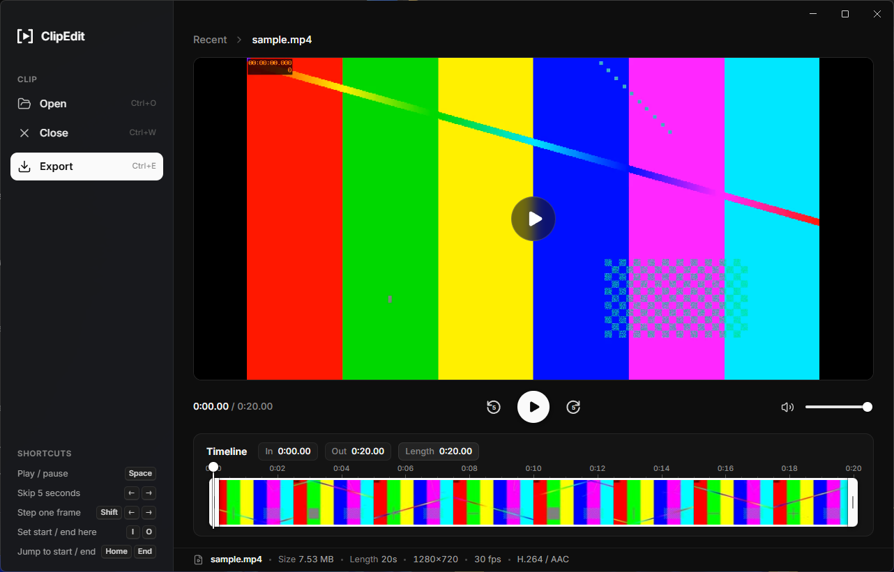
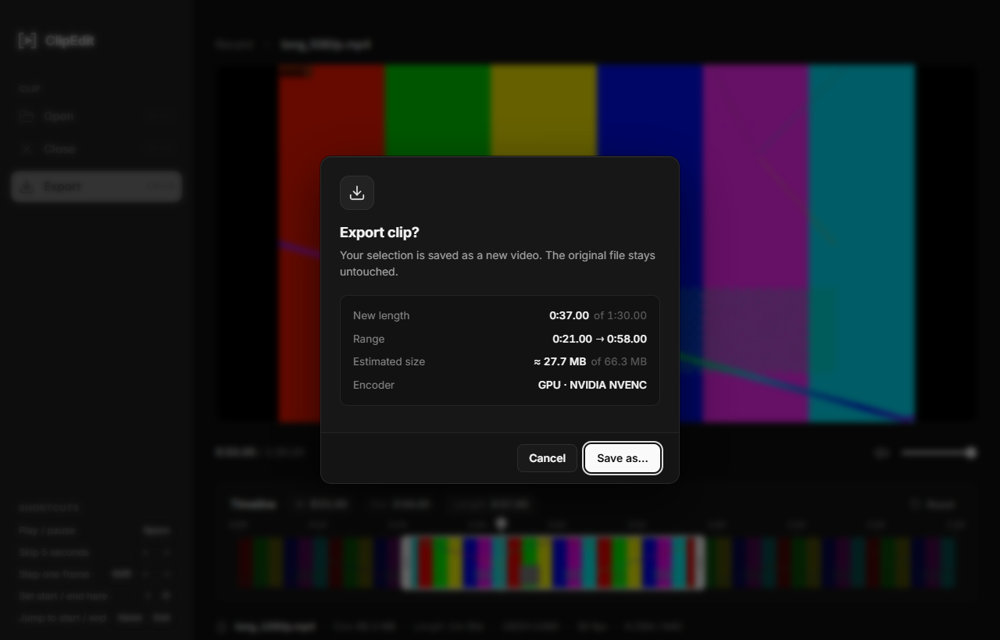
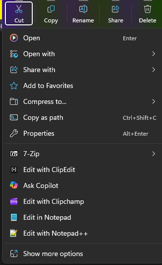
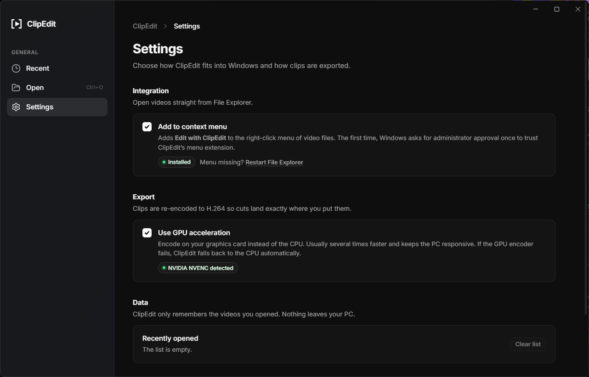

<div align="center">


# ClipEdit

**A fast, minimal clip editor for Windows, built right into the right-click menu.**

Right-click a video, drag the `[` `]` handles, and export. That's it.

[](https://github.com/0wl/clipedit/releases/latest)


[](LICENSE)



</div>

---

## Why

Cutting a few seconds out of a recording shouldn't mean opening a full video editor. ClipEdit opens straight from File Explorer, plays the video, lets you mark the part you want and saves it as a new file. The original is never touched.

## Features

- **Right-click → Edit with ClipEdit**: a top-level entry in the Windows 11 context menu for every common video format, not hidden under *Show more options*.
- **Trim by dragging**: `[` and `]` handles on a thumbnail timeline. The video previews the exact frame while you drag, and you can slide the whole selection.
- **Frame-accurate export**: clips are re-encoded to H.264, so cuts land exactly where you put them, not on the nearest keyframe.
- **GPU acceleration**: NVIDIA NVENC, AMD AMF or Intel Quick Sync, detected automatically. If the GPU fails, the export falls back to the CPU.
- **Export flow**:
  1. A confirmation shows the new length, estimated size and encoder.
  2. You name the file and pick where it goes.
  3. A progress bar shows the ETA and speed, and you can cancel.
- **Opens almost anything**: MP4, MOV, MKV, WebM, AVI, WMV, FLV, MPEG, TS/M2TS, 3GP and OGV. Formats the player can't show directly get a quick preview copy automatically.
- **Recently opened**: a home screen with thumbnails and length badges. Each video has one-click buttons and a right-click menu to copy the file, open its folder or delete it.
- **Native Windows 11 look**: a dark theme with a Mica sidebar.

<table>
  <tr>
    <td width="68%"></td>
    <td></td>
  </tr>
  <tr>
    <td colspan="2"></td>
  </tr>
</table>

## Install

1. Download **`ClipEdit-Setup-x.y.z.exe`** from the [latest release](https://github.com/0wl/clipedit/releases/latest).
2. Run it. ClipEdit installs per-user, so no admin rights are needed. It adds Start menu and desktop shortcuts.
3. Optional: open **Settings → Add to context menu**.
   - Windows asks for administrator approval once. This lets it trust ClipEdit's self-signed menu extension (the certificate is added to `LocalMachine\TrustedPeople`).
   - Turning the setting off, or uninstalling ClipEdit, removes the menu entry again.

> Windows may show a SmartScreen warning because the installer isn't code-signed. Click **More info → Run anyway**.

## Keyboard shortcuts

| Action | Keys |
| --- | --- |
| Play / pause | `Space` |
| Skip 5 seconds | `←` `→` |
| Step one frame | `Shift` + `←` `→` |
| Set start / end at the playhead | `I` / `O` |
| Jump to start / end | `Home` / `End` |
| Open a video | `Ctrl` + `O` |
| Export | `Ctrl` + `E` |
| Close the video | `Ctrl` + `W` |

## Build from source

You need Node.js 20 or newer, Python 3 with Pillow (only to regenerate icons), and Visual Studio 2022 with the Windows 10/11 SDK (only for the context-menu extension).

```bash
npm install
npm run fetch-ffmpeg     # downloads FFmpeg 7.1.1 (essentials) into resources/ffmpeg
npm run build:shell      # optional: builds + signs the Explorer menu MSIX into resources/shell
npm run dev              # run with hot reload
npm run dist             # build the installer into release/
```

`build:shell` creates its own self-signed certificate the first time. The private key stays in `shell/build/` and is git-ignored. Never share it.

### Tests

```bash
npm run typecheck
npm test                         # unit tests (Vitest)
npm run fixtures                 # generates the test videos (once)
npm run build && npm run e2e     # end-to-end tests that drive the real app (Playwright)
```

### Project layout

| Path | What's inside |
| --- | --- |
| `src/main` | Electron main process: FFmpeg jobs (probe, thumbnails, preview, export), GPU detection, the media streaming protocol, settings, Explorer integration |
| `src/renderer` | The UI (React): Home, Settings, Editor, timeline and export dialogs |
| `src/shared` | Pure logic covered by unit tests: trim math, FFmpeg arguments, progress parsing, formats |
| `shell/` | Windows 11 context-menu extension: an `IExplorerCommand` COM DLL hosted by a signed MSIX package |

## Why FFmpeg 7.1.1?

ClipEdit pins FFmpeg 7.1.1 because its NVENC support works with NVIDIA drivers from roughly version 531 onward. Newer FFmpeg builds need driver 610 or newer, which would silently disable GPU export on many PCs.

## License

ClipEdit is released under the [MIT License](LICENSE).

The installer bundles [FFmpeg](https://ffmpeg.org) (the GPL build by [gyan.dev](https://www.gyan.dev/ffmpeg/builds/)), which is licensed separately under the GPLv3. FFmpeg's source code is available at [ffmpeg.org](https://ffmpeg.org/download.html).
